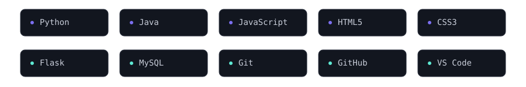
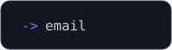
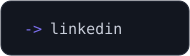
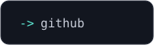

I'm a full-stack developer and student based in Tirunelveli, India. I like building tools that make development faster and more collaborative — real-time editors, AI-assisted workflows, and small platforms that turn raw data into something people can actually read.

### Currently

- Building **DevSync**, a real-time collaborative coding environment
- Learning system design and AI-assisted software engineering
- Open to student developer roles and open-source collaboration

### Stack

### Featured work

**Student Performance Analysis System**
A Python tool that stores academic records and turns them into readable performance reports — built so evaluators can spot trends across a class instead of parsing raw marks sheets by hand.
`Python` · [source](https://github.com/drawwithcjcom-ai)

### Activity

  
  

### Contact

  
  
  

